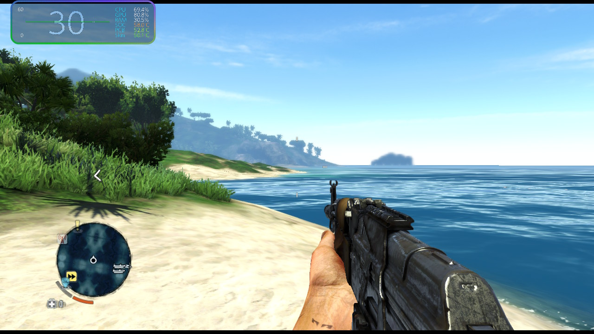

# Far Cry 3 for Nintendo Switch (unofficial port)

Version v0.1.0-preview

An unofficial, non-commercial port of the Xbox 360 version of Far Cry 3 to the Nintendo Switch, made by static
recompilation with [ReXGlue](https://github.com/rexglue/rexglue-sdk) and drawn with a deko3d renderer. It is not an emulator.
Not affiliated with or endorsed by Ubisoft or Nintendo. Far Cry is a trademark of Ubisoft.

**The game disc files and the title update are not included.** You need your own copy of the game and its title update.

## Screenshots

Captured on a Switch on builds from 12 to 21 November 2026, before this preview: the picture may differ. The overlay is Status Monitor.



| | |
|---|---|
|  |  |
|  |  |


## Download and install

Release destination: the private repository [plv890/fc3-switch-release](https://github.com/plv890/fc3-switch-release/releases).
The package is named `fc3-switch-v0.1.0-preview.zip`; access requires permission to that repository.

The archive contains:

```text
prepare_update.py
README.md
INSTALL.md
SWITCH-QUICK-GUIDE.md
LICENSE
THIRD_PARTY_NOTICES.md
licenses/
SHA256SUMS.txt
switch/fc3-nx/
  fc3.nro
  fc3dk_shaders.dslib
  fc3.toml
```

Game disc files, title update payloads, saves and a HOME forwarder are not bundled.

1. Extract the release archive on your PC and copy its `switch` folder to the SD card root.
2. Create `switch/fc3-nx/game_root/` and `switch/fc3-nx/update/` if needed.
3. Extract your own Xbox 360 ISO with an Xbox 360-compatible extraction tool, then **copy the extracted tree's contents**
   into `game_root/`, with `default.xex` directly inside it. Copying the `.iso`, or only unpacking an outer ZIP to get
   an ISO, does not work. Keep `.dat`/`.fat` archives intact; do not unpack them. `$SystemUpdate` is unnecessary.
4. Put your extracted `default.xex` and Title Update 5 file `tu00000004_00000000` beside the archive-root
   `prepare_update.py` on your PC, then run `python prepare_update.py` without path arguments. It creates an `update/`
   folder beside itself. Copy its `patch.dat` and `patch.fat` into `switch/fc3-nx/update/` on the SD, not into `game_root/`.
   Do not redistribute these generated files.
5. Launch hbmenu in application mode (commonly by holding **R** while launching a game), then select Far Cry 3.
   Do not use Album/applet mode.

Full instructions and hashes: [INSTALL.md](INSTALL.md). Everyday use: [SWITCH-QUICK-GUIDE.md](SWITCH-QUICK-GUIDE.md).

## Supported game

Only one edition is supported. The game and the title update must have the same Media ID.

| | |
|---|---|
| Title ID | `5553088C` |
| Media ID | `003B8D49` |
| `default.xex` version | 0.0.0.4 |
| Title update | Title Update 5 for Media ID `003B8D49` (required) |

Title Update 5 for Media ID `6F6EAD36` belongs to another edition and does not fit. Other editions: not verified.

## Preview status

Owner reports the release setup has been tested on their console; no independent clean-install validation across other hardware.

- Booting, loading saves, open-world gameplay and cutscenes have been reported on one console.
- This is a preview, not a stable release or a verified full playthrough. There is no guaranteed 30 FPS.
- Measurements on one overclocked console were around 25 FPS with drops below 20; they do not establish stock-clock
  performance. Other console models and firmwares have not been independently validated.
- Known bugs include lighting and texture glitches in some scenes.
- Music can be turned off by the game's own setting, available only in the main menu options.
- With the Xbox button layout, **Switch B confirms** and **Switch A cancels** in-game. The Switch system UI uses **A** to confirm.
- The release NRO and shader library match the installed binaries; full SHA-256 values are in [INSTALL.md](INSTALL.md).
- The supplied configuration matches the installed values except `log_network = "127.0.0.1:28771"`.
  Keep this nonempty: this build needs it for socket initialization. Loopback is not the owner's network destination;
  no listener or remote IP is required.
- The source in this repository is close to the released build but not identical to it.

## Contents

| Folder | What it is |
|---|---|
| `app/` | the port: hooks, configuration, renderer glue |
| `sdk/` | modified ReXGlue SDK with the Switch layer and the deko3d renderer |
| `shaders/` | shader translation tools |
| `patches/`, `mesa/` | changes to third-party code |
| `tools/` | build tools |
| `release/` | the SD card layout of the release |

## License and credits

GPL-3.0, see [LICENSE](LICENSE). Parts are under other licenses, see [THIRD_PARTY_NOTICES.md](THIRD_PARTY_NOTICES.md).
Based on [fc3-nx](https://github.com/barbaruiva25/fc3-nx) and the projects listed there.
