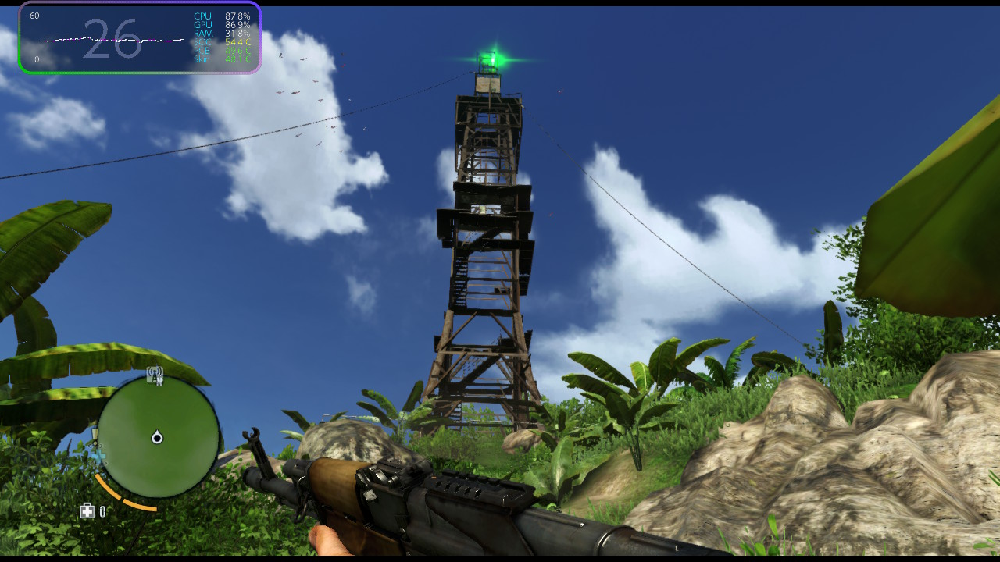
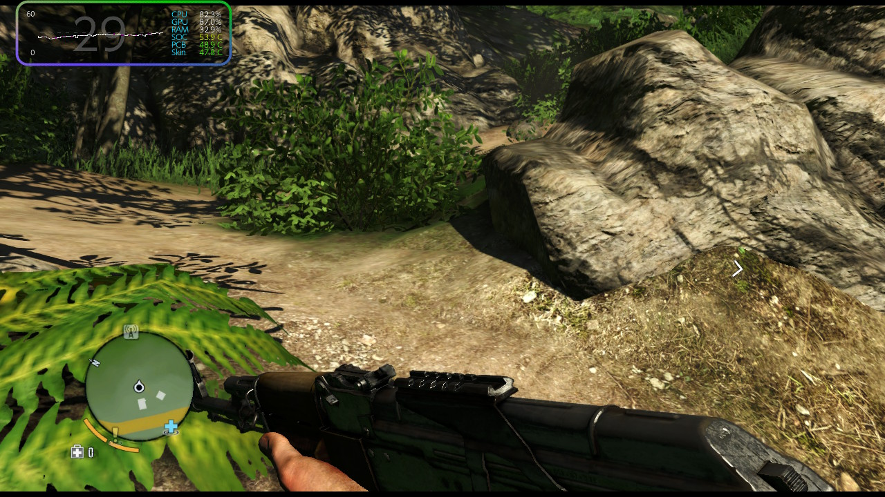
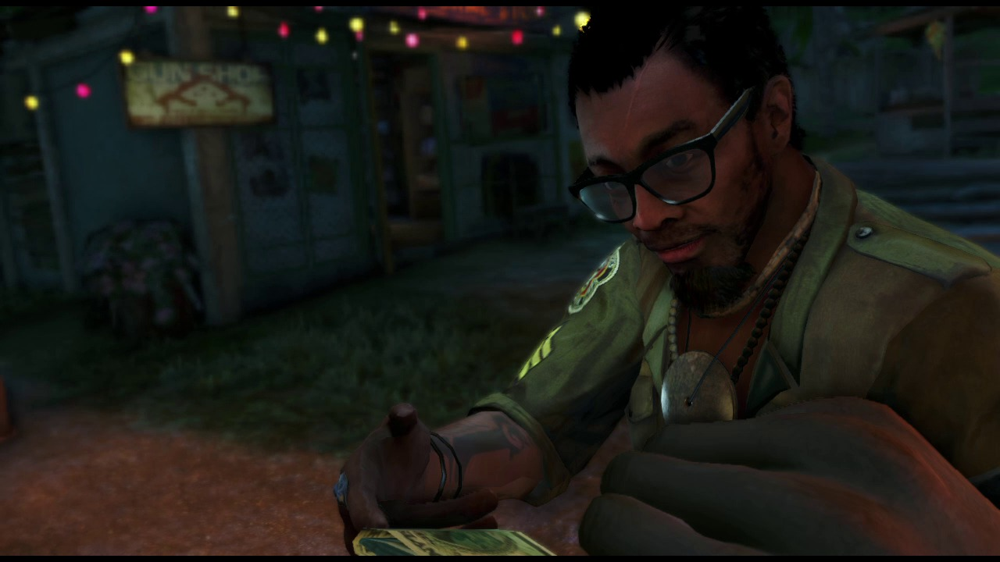
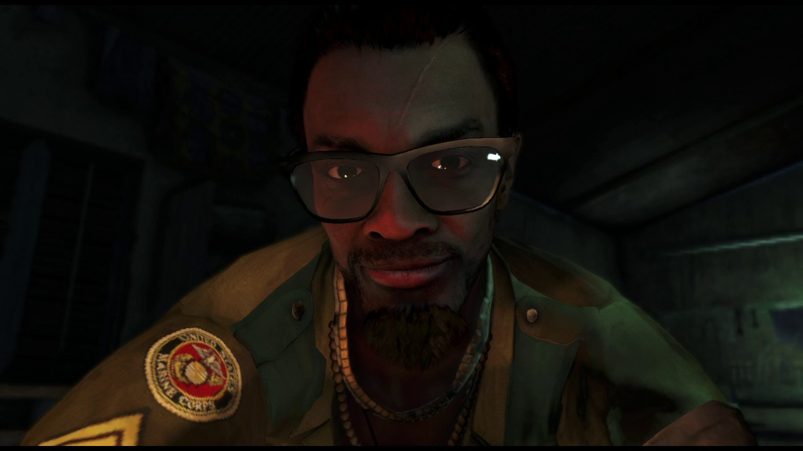
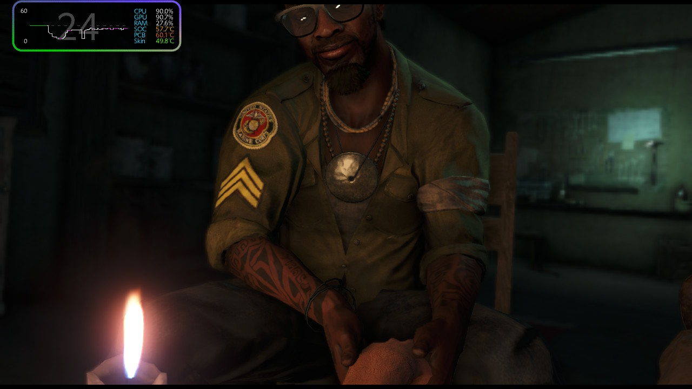

# Far Cry 3 for Nintendo Switch (unofficial port)

Version 1.0

An unofficial, non-commercial port of the Xbox 360 version of Far Cry 3 to the Nintendo Switch, made by static
recompilation with [ReXGlue](https://github.com/rexglue/rexglue-sdk) and drawn with a deko3d renderer. It is not an emulator.
Not affiliated with or endorsed by Ubisoft or Nintendo. Far Cry is a trademark of Ubisoft.

**The game disc files and the title update are not included.** You need your own copy of the game and its title update.

## Screenshots

Captured on a Switch on builds from 12 to 21 November 2026, older than 1.0: the picture may differ. The overlay is Status Monitor.


| | |
|---|---|
|  |  |
|  |  |



## Download and install

Get the archive from **Releases**. It is laid out for the SD card:

```
switch/fc3-nx/
  fc3.nro                the port
  fc3dk_shaders.dslib    shader library
  fc3.toml               settings
  game_root/             your own game files go here
  update/                your own patch.dat and patch.fat go here
pc/prepare_update.py     unpacks your own title update on a PC
```

1. Copy `switch` to the root of the SD card.
2. Copy the files of your own disc into `switch/fc3-nx/game_root/`.
3. Unpack your own Title Update 5 with `prepare_update.py` and copy the two files into `switch/fc3-nx/update/`.
4. Start it in application mode, not from the Album.

Full guide with hashes: [INSTALL.md](INSTALL.md).

## Supported game

Only one edition is supported. The game and the title update must have the same Media ID.

| | |
|---|---|
| Title ID | `5553088C` |
| Media ID | `003B8D49` |
| `default.xex` version | 0.0.0.4 |
| Title update | Title Update 5 for Media ID `003B8D49` (required) |

Title Update 5 for Media ID `6F6EAD36` belongs to another edition and does not fit. Other editions: not verified.

## State of 1.0

- Boots from the HOME menu, loads saves, open world and cutscenes run.
- Target 30 FPS. Usually around 25, with drops below 20. Limited by the CPU.
- Known bugs: lighting and texture glitches in some scenes.
- Music can be turned off by the game's own setting, which is only in the main menu options.
- Tested on **one console only** (firmware 21.1.0, Atmosphere), overclocked: CPU 2091 MHz, GPU 1075 MHz,
  RAM 3000 MHz in the Horizon OC profile. CPU 2.3 GHz: not verified. Overclocking is at your own risk.
- Stock clocks, other console models and firmwares: not verified.
- Installation on a clean SD card: not verified.
- The source in this repository is close to the released build but not identical to it.

## Contents

| Folder | What it is |
|---|---|
| `app/` | the port: hooks, configuration, renderer glue |
| `sdk/` | modified ReXGlue SDK with the Switch layer and the deko3d renderer |
| `shaders/` | shader translation tools |
| `patches/`, `mesa/` | changes to third-party code |
| `tools/` | build tools |
| `release/` | the SD card layout of the release |

## License and credits

GPL-3.0, see [LICENSE](LICENSE). Parts are under other licenses, see [THIRD_PARTY_NOTICES.md](THIRD_PARTY_NOTICES.md).
Based on [fc3-nx](https://github.com/barbaruiva25/fc3-nx) and the projects listed there.
